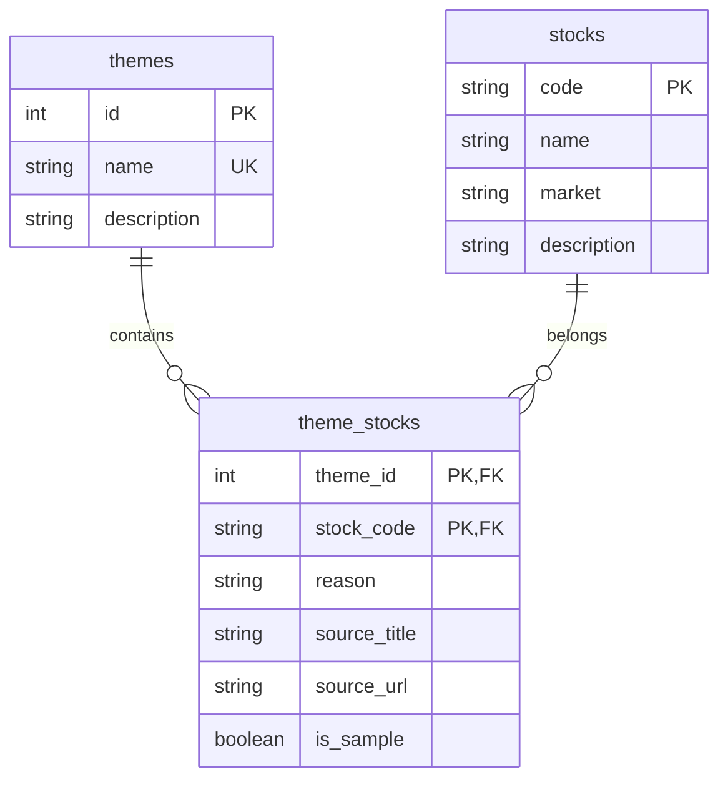

# 2차 보고를 위한 백엔드 진행 정리

작성 기준 2026년 11월 17일 · 보고 예정 2026년 11월 18일

## 이번에 진행한 내용

1차 기획의 테마 검색·관련 종목 조회·종목 상세 기능을 FastAPI 조회 API로 구현했다. 테마와 종목을 연결 테이블로 분리하고, 연관 이유와 출처를 연결 관계에 저장하도록 설계했다. 한 종목이 여러 테마에 포함되는 경우를 가상 데이터로 검증했다.

AI 개발 도구의 도움으로 코드·환경 설정·테스트 초안을 작성하고 자동 실행으로 검증했다. 본인의 수행 내용은 코드를 읽고 실행 결과를 확인한 범위에 맞춰 설명한다. 실제 수행하지 않은 수동 검토나 팀원 작업을 개인 기여로 기록하지 않는다.

| 구분 | 현재 상태 | 증빙 |
|---|---|---|
| 테마 검색·종목 목록·종목 상세 API | 구현 | app/main.py |
| 테마·종목 다대다 관계 | 구현 | app/models.py |
| 가상 데이터 | 테마 3개, 기업 4개, 관계 5개 | app/seed.py |
| 오류 처리 | 404, 422, 검색 결과 없음 | tests/test_api.py |
| 자동 테스트 | Windows / Python 3.11 / SQLite에서 16개 통과 | docs/test-results.txt |
| API 계약 | OpenAPI JSON 및 Swagger UI | docs/openapi.json, /docs |
| PostgreSQL 환경 | GitHub Actions Linux / PostgreSQL 17 테스트 통과 | compose.yaml 및 Actions 실행 #1 |
| PC 간 개발 환경 | Dev Container 설정 작성, 실제 Codespaces 실행 확인 전 | .devcontainer/devcontainer.json |
| 실데이터·관리자·프론트 통합 | 미구현 | 다음 작업 |

## 데이터 구조

연결 테이블의 복합 기본키로 같은 종목·테마의 중복 연결을 막고 외래키로 존재하지 않는 종목·테마의 연결을 막는다. 종목 코드의 앞자리 0을 보존하기 위해 숫자가 아닌 문자열로 저장한다.

## 3분 시연 순서

1. 서버 실행 후 `/health`: status=ok와 실제 DB 종류를 보여준다.
2. `/docs`에서 GET `/api/themes` → Try it out → q에 `반도` 입력 → Execute. 반도체 테마만 조회되는지 보여준다.
3. GET `/api/themes/{theme_id}/stocks`의 theme_id=1 실행. 종목과 관련 이유, is_sample=true, source_url=null을 설명한다.
4. GET `/api/stocks/{code}`의 code=900001 실행. 반도체·인공지능 두 테마가 반환되는 것을 보여준다.
5. code=000000은 404, code=abc는 422임을 보여준다.
6. `python -m pytest -q`로 테스트를 실행한다.

## 발표 문장 예시

“지난 보고에서 정한 조회 기능을 백엔드 API로 구현했습니다. 테마와 종목은 다대다 관계이므로 연결 테이블을 두었고, 연결마다 연관 이유와 출처를 저장하도록 했습니다. 현재는 가상 기업으로 조회 흐름을 검증했고, SQLite 환경에서 자동 테스트 16개를 통과했습니다. GitHub의 Linux 환경에서도 SQLite와 PostgreSQL 테스트를 통과했습니다. 다른 PC에서 사용할 개발 환경 설정을 작성했으며 Codespaces 실제 실행 검증은 다음 단계입니다.”

## 다음 작업

프론트 담당자에게 OpenAPI 계약을 전달하고 응답 형식을 합의한다. Codespaces에서 개발 환경 실행을 확인한 뒤 실데이터 출처·이용 조건을 검토한다. 관리자가 테마와 연결 근거를 수정하는 기능은 인증 및 스키마 마이그레이션과 함께 구현한다.

## 원격 검증 증빙

[GitHub Actions 실행 #1](https://github.com/asfdasdf-mnu/thememap-backend/actions/runs/43922277701): sqlite 및 postgres 작업 성공. 검증한 코드 커밋은 829b24819f4a499a320fb14564da3bbed23dfdb2.
